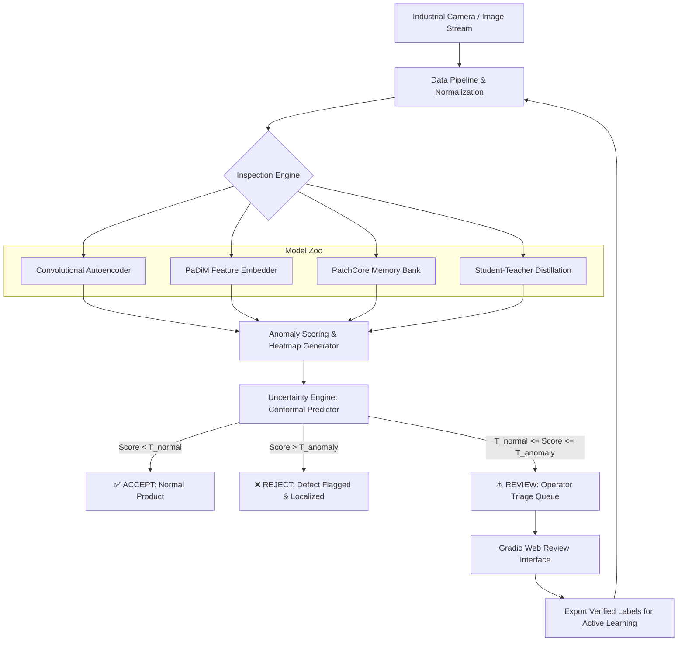
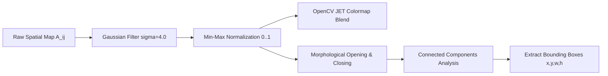
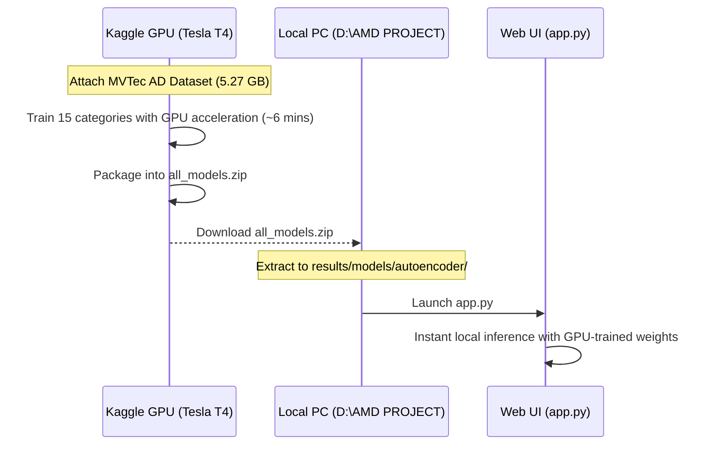

# 📖 VisionInspect AI — Technical Documentation & System Specification
### Industrial Defect Detection With Limited Training Data & Uncertainty-Gated Human Review

---

## 📑 Table of Contents
1. [Executive Summary](#1-executive-summary)
2. [Problem Statement & Research Objectives](#2-problem-statement--research-objectives)
3. [System Architecture & Design](#3-system-architecture--design)
4. [Theoretical Formulation & Models](#4-theoretical-formulation--models)
   - 4.1 [Convolutional Autoencoder (CAE) with Joint SSIM Loss](#41-convolutional-autoencoder-cae-with-joint-ssim-loss)
   - 4.2 [Patch Distribution Modeling (PaDiM)](#42-patch-distribution-modeling-padim)
   - 4.3 [PatchCore Memory Bank & Greedy Coreset](#43-patchcore-memory-bank--greedy-coreset)
   - 4.4 [Student-Teacher Feature Distillation Ensemble](#44-student-teacher-feature-distillation-ensemble)
5. [Uncertainty Quantification & Human-in-the-Loop](#5-uncertainty-quantification--human-in-the-loop)
   - 5.1 [Split Conformal Prediction Framework](#51-split-conformal-prediction-framework)
   - 5.2 [Monte Carlo Dropout Variance Estimation](#52-monte-carlo-dropout-variance-estimation)
   - 5.3 [Persistent Review Queue & Active Learning Loop](#53-persistent-review-queue--active-learning-loop)
6. [Defect Localization & Anomaly Map Pipeline](#6-defect-localization--anomaly-map-pipeline)
7. [Evaluation Metrics & Benchmarking Protocol](#7-evaluation-metrics--benchmarking-protocol)
8. [Software Architecture & File Layout](#8-software-architecture--file-layout)
9. [User Guide & Operations Manual](#9-user-guide--operations-manual)
   - 9.1 [CLI Workflows (Train, Evaluate, Inspect)](#91-cli-workflows-train-evaluate-inspect)
   - 9.2 [Web Dashboard (app.py)](#92-web-dashboard-apppy)
   - 9.3 [Cloud GPU Training (Kaggle) & Local Weight Synchronization](#93-cloud-gpu-training-kaggle--local-weight-synchronization)
10. [Future Research Roadmap](#10-future-research-roadmap)

---

## 1. Executive Summary

Manufacturing automated visual inspection systems have traditionally relied on supervised deep convolutional networks requiring thousands of labeled images per defect class. However, modern high-precision fabrication plants face three persistent bottlenecks:
1. **Defect Scarcity:** Defective parts occur rarely ($<0.1\%$ in modern semiconductor, pharmaceutical, and electronic assembly).
2. **Novelty / Open-Set Defect Classes:** Manufacturing equipment wear or raw material shifts introduce unseen structural anomalies never present in the initial training partition.
3. **High Cost of False Over-Rejection vs. Escape:** Rejecting sound items incurs scrap losses; allowing defective items to reach customers damages brand reliability and safety.

**VisionInspect AI** resolves these limitations through a hybrid paradigm combining:
- **Unsupervised representation learning** trained exclusively on defect-free nominal images.
- **Pixel-precise anomaly heatmaps** localizing microscopic surface scratches, cracks, punctures, and foreign contaminants.
- **Statistically guaranteed conformal uncertainty routing** that partitions inspections into `ACCEPTED (NORMAL)`, `REJECTED (ANOMALY)`, and `UNCERTAIN (FLAGGED FOR HUMAN REVIEW)` with bounded error guarantees.

---

## 2. Problem Statement & Research Objectives

### Core Research Question
> *"Can anomaly detection and uncertainty-aware human review improve the detection of previously unseen manufacturing defects compared with conventional supervised classification when labeled defect data is limited?"*

### Primary Research Objectives
- **Zero-Shot / Few-Shot Anomaly Sensitivity:** Detect structural deviations without requiring pre-labeled training defect exemplars ($k \in \{0, 1, 5, 10, 50\}$).
- **Sub-Component Defect Localization:** Generate accurate spatial heatmaps and bounding-box clusters delineating flaw boundaries for root-cause analysis.
- **Uncertainty-Gated Triage:** Quantify model epistemic and aleatoric uncertainty to reliably redirect borderline samples to human operators, slashing false alarm rates while maintaining $\ge 99\%$ recall on critical defects.
- **Low Inference Latency:** Achieve $<50\text{ ms}$ processing time per image on CPU and $<5\text{ ms}$ on GPU to match real-time production conveyor speeds.

---

## 3. System Architecture & Design

VisionInspect AI is structured into four decoupled, extensible subsystems:



---

## 4. Theoretical Formulation & Models

### 4.1 Convolutional Autoencoder (CAE) with Joint SSIM Loss
The reconstruction baseline learns an identity mapping $f_{\theta}: \mathcal{X} \to \mathcal{X}$ conditioned solely on nominal samples $x \in \mathcal{X}_{\text{normal}}$. 

#### Loss Function
Standard Mean Squared Error (MSE) often produces blurry edges that trigger false positives around high-frequency boundaries. VisionInspect AI introduces a composite structural loss:

$$\mathcal{L}_{\text{total}}(x, \hat{x}) = (1 - \lambda_{\text{ssim}}) \cdot \text{MSE}(x, \hat{x}) + \lambda_{\text{ssim}} \cdot (1 - \text{SSIM}(x, \hat{x}))$$

Where Structural Similarity (SSIM) is computed over local sliding windows:
$$\text{SSIM}(x, \hat{x}) = \frac{(2\mu_x\mu_{\hat{x}} + C_1)(2\sigma_{x\hat{x}} + C_2)}{(\mu_x^2 + \mu_{\hat{x}}^2 + C_1)(\sigma_x^2 + \sigma_{\hat{x}}^2 + C_2)}$$

The pixel anomaly map $A(i, j)$ and image anomaly score $S(x)$ are:
$$A(i, j) = \frac{1}{C}\sum_{c=1}^C (x_{c, i, j} - \hat{x}_{c, i, j})^2, \quad S(x) = \max_{i, j} A(i, j)$$

---

### 4.2 Patch Distribution Modeling (PaDiM)
PaDiM embeds local patch representations extracted across multiple intermediate layers of a frozen pretrained CNN (e.g. `WideResNet-50-2`).
1. **Multi-Scale Feature Concatenation:** Spatial feature maps from layers $l \in \{1, 2, 3\}$ are upsampled to layer 1 resolution and concatenated: $X_{i, j} \in \mathbb{R}^D$.
2. **Dimensionality Reduction:** A deterministic random projection selects $d \ll D$ dimensions.
3. **Parametric Normal Model:** For each spatial position $(i, j)$, a multivariate Gaussian $\mathcal{N}(\mu_{i, j}, \Sigma_{i, j})$ is estimated from normal training images:
   $$\mu_{i, j} = \frac{1}{N}\sum_{k=1}^N x_{i, j}^k, \quad \Sigma_{i, j} = \frac{1}{N-1}\sum_{k=1}^N (x_{i, j}^k - \mu_{i, j})(x_{i, j}^k - \mu_{i, j})^\top + \epsilon I$$
4. **Mahalanobis Distance Map:** At test time:
   $$M(i, j) = \sqrt{(x_{i, j} - \mu_{i, j})^\top \Sigma_{i, j}^{-1} (x_{i, j} - \mu_{i, j})}$$

---

### 4.3 PatchCore Memory Bank & Greedy Coreset
PatchCore addresses localized defect detection by constructing an external coreset memory bank of locally aware neighborhood patch embeddings $\mathcal{M}$.
1. **Locally Aware Patch Embeddings:** Applies adaptive average pooling with stride 1 over features to encode context.
2. **Minimax Facility Location Coreset:** Subsamples nominal patch embeddings down to fraction $\kappa = 0.1$ using iterative greedy selection:
   $$m^* = \arg\max_{m \in \mathcal{P}} \min_{n \in \mathcal{M}_{t-1}} \|m - n\|_2$$
3. **$k$-Nearest Neighbor Anomaly Retrieval:**
   $$A(i, j) = \min_{m \in \mathcal{M}} \|p_{i, j} - m\|_2$$
   The image score uses re-weighted nearest-neighbor distance to suppress outlier noise.

---

### 4.4 Student-Teacher Feature Distillation Ensemble
- A frozen **Teacher** network $T$ extracts deep semantic representations from image patches.
- An ensemble of $K$ lightweight **Student** decoders $\{S_1, S_2, \dots, S_K\}$ are trained to replicate the Teacher's representations on normal images.
- On unseen defective regions, the Students fail to mimic the Teacher, producing large residual divergence.
- The **ensemble variance** directly provides an epistemic uncertainty measure:
   $$U(i, j) = \text{Var}_{k=1}^K \left( S_k(x)_{i, j} \right)$$

---

## 5. Uncertainty Quantification & Human-in-the-Loop

```
                       ANOMALY SCORE CONTINUUM
  0.0                                                          High Score
  ├─── Confirm Normal ───┼─── ROUTE TO HUMAN REVIEW ───┼─── Confirm Defect ───►
  │   (Score < T_norm)   │   [T_norm <= S <= T_anom]   │   (Score >= T_anom)  │
  │                      │                             │                      │
  │   Autonomous Pass    │   Operator inspects heatmap │   Automatic Reject   │
  │   P(error) <= alpha  │   in Web Review Queue       │   P(error) <= alpha  │
```

### 5.1 Split Conformal Prediction Framework
Traditional binary thresholding forces a hard decision on ambiguous border samples. VisionInspect AI integrates **Split Conformal Prediction**:
- Calibration dataset $\mathcal{D}_{\text{cal}} = \{(x_i, y_i)\}_{i=1}^M$ of normal ($y=0$) and defective ($y=1$) images.
- Given allowable false-negative error rate $\alpha_{\text{norm}}$ and false-positive rate $\alpha_{\text{anom}}$:
  $$T_{\text{norm}} = \text{Quantile}\left( \{S(x) \mid y=0\}, 1 - \alpha_{\text{norm}} \right)$$
  $$T_{\text{anom}} = \text{Quantile}\left( \{S(x) \mid y=1\}, \alpha_{\text{anom}} \right)$$
- If $S(x) \in [T_{\text{norm}}, T_{\text{anom}}]$, the model declares **uncertainty** and routes the part to the human operator queue.

### 5.2 Monte Carlo Dropout Variance Estimation
For gradient-trained networks, test-time dropout with $T = 20$ stochastic forward passes computes:
$$\bar{S}(x) = \frac{1}{T}\sum_{t=1}^T S^{(t)}(x), \quad \sigma^2(x) = \frac{1}{T-1}\sum_{t=1}^T \left(S^{(t)}(x) - \bar{S}(x)\right)^2$$
Samples with high variance $\sigma(x) > \tau_{\text{unc}}$ trigger operator intervention.

### 5.3 Persistent Review Queue & Active Learning Loop
- Flagged images, heatmaps, and scores are serialized to `results/review_queue.json`.
- The operator reviews and labels uncertain items via the web dashboard.
- Verified samples are exported via `export_labels()` to augment the training distribution, establishing a closed-loop active learning cycle.

---

## 6. Defect Localization & Anomaly Map Pipeline



1. **Gaussian Smoothing:** $\tilde{A} = A * G_{\sigma=4.0}$ eliminates single-pixel sensor noise.
2. **Min-Max Range Normalization:** Scales the map to $[0, 1]$ interval.
3. **Thermal Jet Colormap:** Red highlights severe deviations; blue indicates nominal texture.
4. **Morphological Filtering:** $5\times 5$ elliptical kernel closes microscopic holes and removes artifacts.
5. **Component Extraction:** Extracts connected components exceeding minimum defect area threshold ($\ge 30 \text{ px}$) and generates bounding boxes.

---

## 7. Evaluation Metrics & Benchmarking Protocol

| Metric | Level | Definition | Importance |
| :--- | :--- | :--- | :--- |
| **Image AUROC** | Image | Area under Receiver Operating Characteristic curve | Overall detection capability across all thresholds |
| **Image AP** | Image | Average Precision (PR-curve area) | Reliable under severe class imbalance |
| **Optimal F1** | Image | Max F1 harmonic mean at optimal threshold $T^*$ | Balanced operational performance |
| **FPR @ 95% TPR** | Image | False positive rate when catching $95\%$ of defects | Measures false scrap cost |
| **Pixel AUROC** | Pixel | Per-pixel true positive vs false positive rate | Segmentation sensitivity |
| **PRO Score** | Pixel | Per-Region Overlap integrated up to $\text{FPR}=0.3$ | Localisation quality on small vs large defects |
| **Latency (ms)** | System | Mean wall-clock inference duration per frame | Production throughput compatibility |

---

## 8. Software Architecture & File Layout

```
d:\AMD PROJECT\
├── data/
│   └── raw/mvtec/                     # Dataset storage (15 categories)
├── experiments/                       # Model experiment YAML configs
│   ├── autoencoder_mvtec.yaml
│   ├── padim_mvtec.yaml
│   └── patchcore_mvtec.yaml
├── results/
│   ├── eval/                          # Evaluation outputs & metrics.json
│   ├── inspection/                    # Heatmap overlays & JSON reports
│   ├── models/                        # Serialized .pt weight checkpoints
│   └── review_queue.json              # Persistent human review database
├── scripts/
│   ├── download_mvtec.py              # Automated 4.9 GB MVTec downloader
│   ├── generate_synthetic_data.py     # Offline synthetic data generator
│   ├── run_benchmarks.py              # Few-shot k-value benchmark runner
│   └── train_all.py                   # Automated batch trainer for all categories
├── src/
│   ├── data/                          # Dataset loaders & transforms
│   ├── evaluation/                    # Metrics (AUROC, PRO, F1) & benchmarks
│   ├── human_review/                  # ReviewQueue & operator dashboard logic
│   ├── localization/                  # AnomalyMapProcessor & GradCAMLocalizer
│   ├── models/                        # Autoencoder, PaDiM, PatchCore, StudentTeacher
│   ├── uncertainty/                   # ConformalPredictor & MCDropoutWrapper
│   └── utils/                         # Visualization & logging
├── tests/
│   └── test_pipeline.py               # Automated pytest suite
├── .gitignore                         # Excludes .venv, large datasets, checkpoints
├── app.py                             # Gradio Web Dashboard (3-Tab Interface)
├── evaluate.py                        # Standalone evaluation CLI
├── requirements.txt                   # Complete dependency specification
├── run_inspection.py                  # Single-image & folder inspection CLI
├── setup.py                           # Pip installable package setup
├── start_app.bat                      # 1-Click Windows batch launcher
├── start_app.ps1                      # 1-Click PowerShell launcher
└── train.py                           # Standalone training CLI
```

---

## 9. User Guide & Operations Manual

### 9.1 CLI Workflows

#### Run Pipeline Tests
```powershell
python -m pytest tests/test_pipeline.py -v
```

#### Train on a Category (CPU or GPU)
```powershell
python train.py --model autoencoder --category cable --epochs 25 --device cpu --workers 0
```

#### Run Comprehensive Evaluation & Calibrate Uncertainty
```powershell
python evaluate.py --model autoencoder --category cable --device cpu --workers 0
```

#### Inspect an Individual Part
```powershell
python run_inspection.py --image data/raw/mvtec/cable/test/cut_wire/000.png --model autoencoder --category cable --threshold 2.59
```

---

### 9.2 Web Dashboard (`app.py`)

Launch via:
```powershell
python app.py
# or double click start_app.bat
```
Navigate to **`http://127.0.0.1:7860`**:

1. **Tab 1: Live Product Inspection:**
   - Upload any product image or pick a sample.
   - Choose model and category.
   - Set threshold and conformal uncertainty bounds.
   - Inspect 4-panel visual evidence (Original | Anomaly Heatmap | Blended Overlay | Defect Bounding Boxes).
   - Click *Send to Human Review Queue* if the verdict is uncertain.
2. **Tab 2: Human-in-the-Loop Review Queue:**
   - Review pending ambiguous samples.
   - Click `Confirm Normal (False Alarm)` or `Confirm Defect (Reject)`.
   - Add notes and export verified active-learning manifests.
3. **Tab 3: Benchmarks & Quality Reports:**
   - View live AUROC, optimal thresholds, and telemetry charts.

---

### 9.3 Cloud GPU Training (Kaggle) & Local Weight Synchronization



1. Attach dataset `ipythonx/mvtec-ad` on Kaggle.
2. Run the multi-category training cell.
3. Download `all_models.zip` from Kaggle Output.
4. Extract to `D:\AMD PROJECT\results\models\autoencoder\`.
5. Local inference immediately activates across all 15 categories without retraining.

---

## 10. Future Research Roadmap

1. **PatchCore Memory Compression via Product Quantization (PQ):**
   Accelerate large memory bank retrieval using FAISS inverted file with product quantization (`IndexIVFPQ`) to achieve sub-millisecond retrieval on edge devices.
2. **Multi-Modal Visual-Language Alignment (WinCLIP / CLIP-AD):**
   Incorporate text prompt priors (e.g. *"a cable with cut copper strands"*) for zero-shot text-prompt guided defect classification.
3. **Cross-Illumination Domain Generalization:**
   Implement photometric invariance loss to maintain consistent anomaly scores across factory lighting fluctuations.
